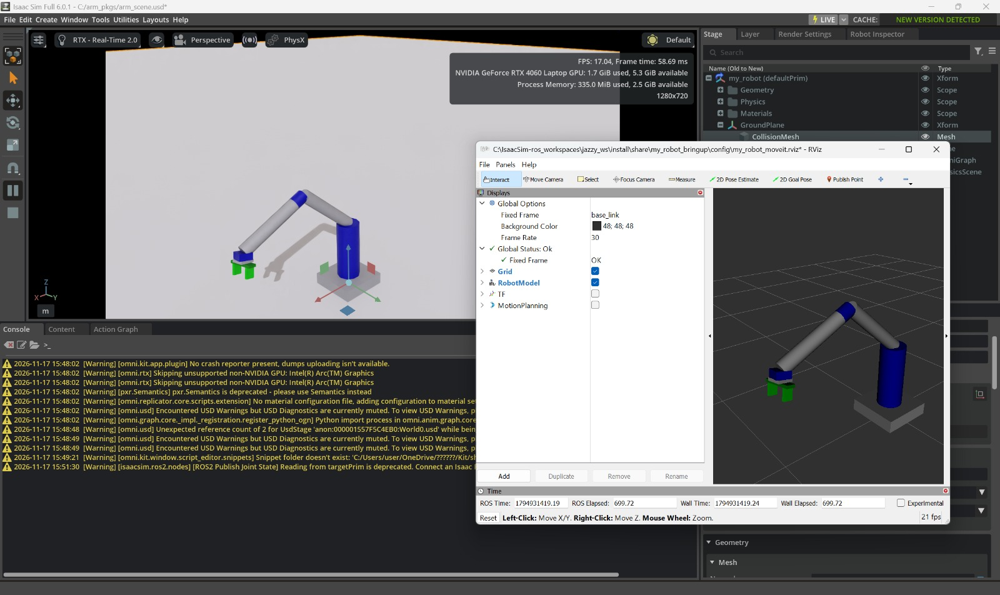
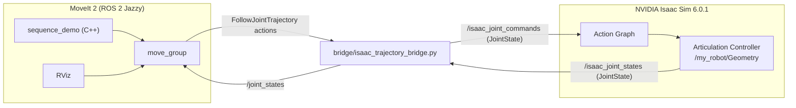

<div align="center">

# 6-DOF Arm: MoveIt 2 + NVIDIA Isaac Sim on Windows

**A custom 6-DOF robot arm with a parallel gripper, planned by MoveIt 2 and executed in NVIDIA Isaac Sim, running natively on Windows through a custom Python trajectory bridge over a Zenoh RMW.**

[](https://github.com/shreyas02005-sudo/arm_isaac_sim_moveit2/actions/workflows/ci.yml)
[](LICENSE)
[](https://docs.ros.org/en/jazzy/)
[](https://moveit.ai/)
[](https://developer.nvidia.com/isaac/sim)
[](docs/SETUP_WINDOWS.md)
[](https://github.com/ros2/rmw_zenoh)
[](bridge/isaac_trajectory_bridge.py)
[](ros2_ws/src/my_robot_commander_cpp/src/sequence_demo.cpp)

[Demo video](https://drive.google.com/drive/folders/19aJNf1vs4xFFC0ChF1kgxgATa8SNTinV?usp=sharing) ·
[Architecture](docs/ARCHITECTURE.md) ·
[Setup (Windows)](docs/SETUP_WINDOWS.md) ·
[Isaac scene](docs/ISAAC_SCENE.md) ·
[Troubleshooting](docs/TROUBLESHOOTING.md)



</div>

## Table of contents

- [Overview](#overview)
- [Features](#features)
- [Demo sequence](#demo-sequence)
- [Architecture](#architecture)
- [Verification status](#verification-status)
- [Tested environment](#tested-environment)
- [Repository layout](#repository-layout)
- [Quick start](#quick-start)
- [Named poses](#named-poses)
- [Design decisions](#design-decisions)
- [Known limitations](#known-limitations)
- [Scope](#scope)
- [Possible improvements](#possible-improvements)
- [Continuous integration](#continuous-integration)
- [Where to look first (for reviewers)](#where-to-look-first-for-reviewers)
- [Troubleshooting](#troubleshooting)
- [Author](#author)
- [License](#license)
- [Acknowledgements](#acknowledgements)

## Overview

This project connects a MoveIt 2 motion planning stack to an arm simulated in NVIDIA Isaac Sim, with everything
running natively on Windows 11 (no WSL2, no Linux machine).

The usual way to execute MoveIt plans is `ros2_control`. On the tested Windows setup, `ros2_control_node` crashes
on start-up (`pal_statistics.dll`, exit code `3221225477`) with both mock and topic-based hardware, under both Zenoh
and Fast DDS. This repository works around that with a small Python **trajectory bridge** that acts as the
`FollowJointTrajectory` action server MoveIt expects, forwards the trajectory points to Isaac Sim as joint commands,
and republishes the simulated joint states back to MoveIt.

A C++ program (`sequence_demo`) uses the MoveIt `MoveGroupInterface` API to run a complete pick style sequence.

## Features

- Custom 6-DOF arm and parallel gripper (URDF/xacro, MoveIt configuration generated with the Setup Assistant).
- MoveIt 2 planning with OMPL, driven from RViz or from C++ code.
- Python bridge exposing two `FollowJointTrajectory` action servers
  (`/arm_controller/follow_joint_trajectory`, `/gripper_controller/follow_joint_trajectory`).
- Isaac Sim scene with an Action Graph and Articulation Controller; joint states are fed back to MoveIt.
- Finger mirroring in the bridge, because Isaac Sim ignores the URDF `mimic` rule.
- Open-loop control with a settle wait in the bridge.
- Zenoh transport (`rmw_zenoh_cpp`) on Windows.
- Helper script for a clean shutdown of the MoveIt/bridge stack without closing Isaac Sim.

## Demo sequence

```
home -> pose_2 -> gripper_closed -> pose_1 -> gripper_open
```

The full sequence was run end to end with Isaac Sim staying in sync with MoveIt and was recorded:
[demo video (Google Drive)](https://drive.google.com/drive/folders/19aJNf1vs4xFFC0ChF1kgxgATa8SNTinV?usp=sharing).

## Architecture



Transport between all ROS nodes is `rmw_zenoh_cpp` through a Zenoh router (`pixi run zenoh`).
Further detail is in [docs/ARCHITECTURE.md](docs/ARCHITECTURE.md).

## Verification status

Stated plainly so a reviewer knows what was and was not checked.

| Item | Status |
|---|---|
| Full sequence home -> pose_2 -> gripper_closed -> pose_1 -> gripper_open, Isaac in sync with MoveIt | Run without errors and recorded |
| Bridge, launch file, `moveit_controllers.yaml` timing keys, `sequence_demo` build and run | Used in the recorded run |
| `isaac_sim/scripts/configure_drives.py` | Merged from snippets that were run separately; the merged file was not run as one script |
| `isaac_sim/scripts/disable_link_gravity.py` | Optional and unconfirmed (the `PhysxSchema` import was not verified on Isaac Sim 6.0.1) |
| Action Graph in [docs/ISAAC_SCENE.md](docs/ISAAC_SCENE.md) | Built from the written instructions; node names may differ slightly from the saved scene |
| `scripts/stop_arm.bat` | Provided to fix a stray-process problem; not confirmed run |
| Scene files in `isaac_sim/scene/` | Copy of the scene used in the recorded run; internal references were checked to resolve, but the copy was not re-run from this repository |
| GitHub Actions CI | Lint and build checks only; see [Continuous integration](#continuous-integration) |

## Tested environment

| Item | Version |
|---|---|
| OS | Windows 11 (preview build 26300) |
| GPU / RAM | NVIDIA RTX 4060 Laptop (8 GB VRAM), 16 GB RAM |
| Isaac Sim | 6.0.1 (installed through pixi: `isaacsim==6.0.1.0`) |
| ROS 2 | Jazzy via RoboStack/pixi, MoveIt 2 (`ros-jazzy-moveit >=2.12.4`) |
| RMW | `rmw_zenoh_cpp` |
| Build | colcon + CMake 4.3 + Ninja, Visual Studio Build Tools 2026 (v18, MSVC 19.51) |
| Workspace | NVIDIA `IsaacSim-ros_workspaces` (`jazzy_ws`) |

Joint names: `joint1` to `joint6`, `gripper_left_finger_joint`, `gripper_right_finger_joint` (mimic, multiplier -1).
Articulation root in Isaac Sim: `/my_robot/Geometry`.

## Repository layout

| Path | What it is |
|---|---|
| `bridge/` | `isaac_trajectory_bridge.py` (MoveIt-to-Isaac bridge) and `isaac_arm.launch.xml` |
| `ros2_ws/src/` | The five ROS packages: `my_robot_description`, `my_robot_moveit_config`, `my_robot_bringup`, `my_robot_interfaces`, `my_robot_commander_cpp` |
| `overlay/` | The files that differ from the original packages (already applied in `ros2_ws/src`; kept for reference, see [overlay/README.md](overlay/README.md)) |
| `isaac_sim/scene/` | The saved Isaac scene, `my_robot_1/my_robot.usda` plus its `payloads/` |
| `isaac_sim/scripts/` | Script Editor snippets: configure joint drives, list joints, optional gravity tweak |
| `scripts/stop_arm.bat` | Clean shutdown of the MoveIt/bridge stack without closing Isaac |
| `docs/` | Setup, Isaac scene, architecture, troubleshooting |
| `media/` | Screenshot (the demo video is linked, not stored in git) |
| `.github/` | CI workflow and Dependabot configuration |

## Quick start

Full instructions, including installing and building everything, are in [docs/SETUP_WINDOWS.md](docs/SETUP_WINDOWS.md).
Once built, run each step below in its own Command Prompt, in this order. `WS` is your pixi workspace, for example
`C:\IsaacSim-ros_workspaces\jazzy_ws`.

```cmd
:: 1. Zenoh router
cd /d WS
pixi run zenoh

:: 2. Isaac Sim, then open isaac_sim\scene\my_robot_1\my_robot.usda and press Play
cd /d WS
pixi run sim

:: 3. MoveIt + RViz + bridge (after Isaac is in Play)
cd /d WS
pixi run ros2 launch C:\arm_pkgs\isaac_arm.launch.xml

:: 4. The demo sequence
cd /d WS
pixi run ros2 run my_robot_commander_cpp sequence_demo
```

`isaac_arm.launch.xml` hard codes `C:/arm_pkgs/` for the bridge script path (noted in a comment in the file), so
keep the files from `bridge/` there or edit that path.

Stop the stack with `scripts\stop_arm.bat` (press Ctrl+C once in the launch window first and wait for the prompt).

## Named poses

From the SRDF.

| Group | State | Values |
|---|---|---|
| arm | `home` | all joints 0 |
| arm | `pose_1` | 0, 0.7873, 1.1464, 0.2255, 0.9108, 1.3364 |
| arm | `pose_2` | 0, 0.1796, 1.4503, 0, -0.9281, 2.7597 |
| gripper | `gripper_open` | left finger 0 |
| gripper | `gripper_half_closed` | left finger 0.04 |
| gripper | `gripper_closed` | left finger 0.06 |

## Design decisions

- **A bridge instead of `ros2_control_node`.** The node crashes on this Windows setup, so the bridge implements the
  action interface MoveIt already uses. MoveIt, RViz and the C++ API are unchanged.
- **Isaac Sim as the physics and visual backend.** The Action Graph exchanges `JointState` messages with ROS, so the
  scene stays independent of MoveIt.
- **Settle wait in the bridge.** Control is open loop (no feedback loop on the commands), so the bridge includes a
  settle wait; it was part of the tested version used in the recorded run.
- **Finger mirroring in the bridge.** Isaac Sim ignores the URDF `mimic` rule, so the bridge writes the mirrored
  finger command itself.
- **Zenoh RMW.** Used for transport between all ROS nodes through a Zenoh router.
- **Trajectory execution timing keys** were added to `moveit_controllers.yaml` (see the overlay).

## Known limitations

- `ros2_control_node` is not used (Windows crash); control is through the bridge, which is open loop with a settle check.
- RViz shows `No active joints or end effectors found for group 'arm'` because the plain `rviz2` node is not given
  the kinematics parameters, so the **draggable end-effector marker is unavailable**. Planning from the
  MotionPlanning panel and from code works.
- `commander_template.cpp` (the original commander) is not built on Windows because it needs `example_interfaces`,
  which is not in the pixi environment. Only `test_moveit` and `sequence_demo` are built.
- Isaac Sim ignores the URDF `mimic` rule, so the bridge mirrors the finger itself.
- Connecting Isaac Sim on Windows to ROS inside WSL2 over DDS was tried at length and never worked. Do not use that path.
- The launch file hard codes `C:/arm_pkgs/` for the bridge script.

## Scope

This repository documents one tested setup (see [Tested environment](#tested-environment)). It makes no claims about
real robot hardware, other operating systems, other Isaac Sim or ROS versions, or performance.

## Possible improvements

- Make the bridge script path a launch argument instead of the hard-coded `C:/arm_pkgs/` (not yet tested).
- Re-run `configure_drives.py` as a single script and confirm or remove `disable_link_gravity.py`.
- Add a screenshot of the Action Graph.

## Continuous integration

[`.github/workflows/ci.yml`](.github/workflows/ci.yml) runs on every push and pull request:

| Job | What it checks |
|---|---|
| `lint` | Python files compile, XML/xacro/launch files are well formed, YAML/RViz configs parse, local Markdown links resolve |
| `build` | The ROS packages build with `colcon` in a ROS 2 Jazzy container, and the main xacro expands |

CI runs on Ubuntu to catch syntax and build errors early. It does **not** run Isaac Sim, the bridge against a
simulator or the demo sequence, and it is not a statement that Ubuntu is a supported platform for this project.

## Where to look first (for reviewers)

1. [`bridge/isaac_trajectory_bridge.py`](bridge/isaac_trajectory_bridge.py): the action servers, joint command publishing, settle wait and finger mirroring.
2. [`ros2_ws/src/my_robot_commander_cpp/src/sequence_demo.cpp`](ros2_ws/src/my_robot_commander_cpp/src/sequence_demo.cpp): the demo sequence through `MoveGroupInterface`.
3. [`ros2_ws/src/my_robot_moveit_config/config/moveit_controllers.yaml`](ros2_ws/src/my_robot_moveit_config/config/moveit_controllers.yaml): controller names and trajectory execution timing.
4. [`docs/ARCHITECTURE.md`](docs/ARCHITECTURE.md) and [`docs/ISAAC_SCENE.md`](docs/ISAAC_SCENE.md): how the pieces connect and how the scene is set up.

## Troubleshooting

See [docs/TROUBLESHOOTING.md](docs/TROUBLESHOOTING.md).

## Author

Shreyas R ([@shreyas02005-sudo](https://github.com/shreyas02005-sudo))

## License

Apache-2.0, see [LICENSE](LICENSE).

## Acknowledgements

[ROS 2](https://docs.ros.org/en/jazzy/), [MoveIt 2](https://moveit.ai/),
[NVIDIA Isaac Sim](https://developer.nvidia.com/isaac/sim) and the
[IsaacSim-ros_workspaces](https://github.com/isaac-sim/IsaacSim-ros_workspaces) project,
[rmw_zenoh](https://github.com/ros2/rmw_zenoh), [RoboStack](https://robostack.github.io/) and [pixi](https://pixi.sh/).
